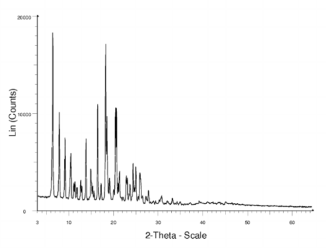
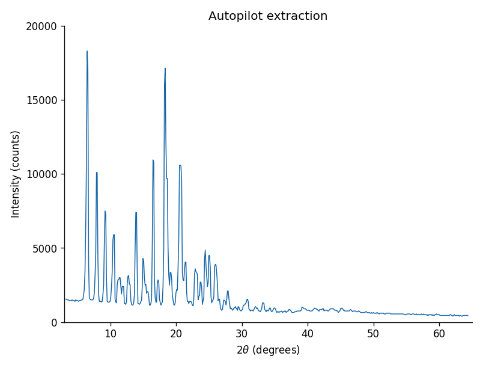

# PlotDigitizer

Reviewable scientific figure digitization for PXRD, Raman and IR plots.
PlotDigitizer turns plot images into numerical curve candidates for scientific
comparison, reference libraries and AI4S data preparation. It combines computer
vision, path tracking and local OCR with visible review of the ROI, axis ticks
and curve identities. Processing stays on your computer.

## Windows downloads

The [Windows preview release](https://github.com/unwatcher/Plot_Digitizer/releases/tag/v0.2.0-preview.1)
provides two ZIP folders, both including portable Python 3.14.10 x64:

- **Ready-to-run:** extract the full folder and double-click `launch_plot_digitizer.bat`.
- **Offline wheels:** extract the full folder, run `install_dependencies.bat`, then launch.
  The installer verifies all 16 local wheels and uses no pip or network access.

No separate Python installation or administrator access is needed. Both packages
include the source, four screened patent examples, dependency license files and
SHA-256 metadata. Windows OCR still uses the language support installed in Windows.

## Run from source

Use 64-bit CPython 3.14. From the repository directory:

```text
python -m venv .venv
```

Activate the environment (`.venv\Scripts\activate` on Windows or
`source .venv/bin/activate` on macOS/Linux), then run:

```text
python -m pip install -r requirements.txt
python plot_digitizer_auto.py
```

The existing `plot_digitizer_auto.py` entry point is preserved. Source is
organized in `plot_digitizer/`; no CrystalTrace installation or catalog is
required. Windows uses its installed OCR language support. If that engine
fails, an installed Tesseract on PATH is used. macOS/Linux need Tesseract for
automatic axis suggestions. Manual calibration works without OCR.

## Automatic mode and review

1. Open an image. Inspect the green plot ROI; draw a replacement if needed.
2. Select **Suggest axis calibration...**. Inspect the tick markers, correct
   values or positions, and apply the reviewed calibration. You can also
   calibrate X and Y manually using visible tick values.
3. Select **Find all curves, then choose**. Automatic mode selects contrast,
   grid handling and upward-peak/downward-dip sampling, then previews candidates.
4. Click the desired curve, filter by color, or add all shown curves. Each
   selected curve becomes a new dataset. Inspect points before exporting CSV,
   JSON or PXRD XRDML.

**X coverage measures sampled image columns.** Separation statuses and orange
bands identify touching or unresolved strokes; they are heuristic diagnostics.
They do not give calibrated probabilities or prove correct curve identity.
Calibration proposals are always reviewed before being applied.

## Handling difficult figures manually

| Situation | Manual recovery |
| --- | --- |
| Incorrect ROI or labels included | Draw a tight ROI around one plot panel and repeat extraction. |
| Faint trace, dense grid or wrong peak direction | Adjust the threshold, grid strength and topmost/bottommost selection. Normal, Grid, Waterfall and IR presets are available. |
| Same-color curves cross or merge | Inspect orange regions; isolate one curve with a Y-band/ROI where possible, use manual tracing through ambiguous portions, and reject incorrect points. Curve identities at crossings can remain unresolved. |
| OCR misses or misreads labels | Edit tick/value rows, click the correct ticks, or calibrate both axes manually. |
| IR/Raman axis changes scale along the plot | Use one consistent scale interval at a time. Calibrate and export each interval separately before changing calibration, then combine the reviewed segments externally. |

Use **Reject Points in Box** to remove incorrect points from the active dataset;
Ctrl+Z restores the last rejection. Linear, logarithmic and decreasing axes are
supported. A single global fit cannot represent a broken or piecewise axis.
Calibration is shared across datasets in the current window. Stacked-curve
offsets are retained as displayed and should be interpreted explicitly.

## Four patent examples

One example is shown before and after extraction:

| Original PXRD patent plot | Extracted numerical curve |
| --- | --- |
|  |  |

Autopilot chose the Normal preset and threshold 160, retaining 563 observed
points. Axes in the extracted preview use reviewed printed tick coordinates;
no smoothing or filling of missing columns is applied. The
[CSV](examples/pxrd-extracted.csv) and [calibration/settings record](examples/pxrd-extraction.json)
are included. Recreate the preview with `python scripts/render_example.py`.

Only four U.S. utility-patent plot crops are bundled, from two patent families:

| File in `examples/patent_plots/` | Source | Purpose |
| --- | --- | --- |
| `us8198452b2-fig1.png` | US8198452B2, Fig. 1 | Single PXRD trace |
| `us8198452b2-fig4.png` | US8198452B2, Fig. 4 | Faint Raman trace |
| `us8198452b2-fig7.png` | US8198452B2, Fig. 7 | Downward IR absorption dips; inspect axis spacing |
| `us6583283b1-fig8.png` | US6583283B1, Fig. 8 | Three stacked Raman curves and review diagnostics |

The [example provenance and reuse note](examples/README.md) records the selection
basis. The manifest includes source PDF URLs/hashes, page/crop/rotation details,
notice checks and sparse visual landmarks. No WIPO/Australian figures or supplied
clipboard scans are included. The software's BSD license is separate from the
figure reuse basis.

These are inspected examples and regression checks, not an independent accuracy
study. The earlier larger development corpus is not distributed here, and its
aggregate figures should not be read as performance claims for this example set.
Full curve identity and numeric calibration accuracy need independent validation.

## Headless use and module boundaries

Install `requirements-core.txt` for extraction and calibration inference without
Qt or Matplotlib:

```python
import cv2
from plot_digitizer import extract_plot_curves

bgr = cv2.imread("plot.png")
if bgr is None:
    raise ValueError("Could not read plot.png")
result = extract_plot_curves(cv2.cvtColor(bgr, cv2.COLOR_BGR2RGB))
# Review result["roi"], candidates, overlap_regions and threshold_trials.
```

Candidate coordinates are source-image pixels. Applying reviewed axis
calibration is a separate step. Inputs are preserved. Cancellation callbacks,
bounded image working resolution and local-OCR timeouts are supported.

| Module | Responsibility |
| --- | --- |
| `digitizer_core.py` | ROI, presets, curve extraction and separation diagnostics |
| `axis_ocr.py` | Local OCR adapters, word boxes and subprocess lifecycle |
| `axis_calibration.py` | Numeric parsing, observed-tick matching and fit validation |
| `gui.py` | Qt workers, review/correction, export and optional host integration |

CSV/JSON preserve floating-point coordinates, including small log-axis values.
XRDML exports integer PXRD counts and is intended for diffraction software.
Current exports do not bundle the complete source image/calibration/settings
audit record; retain that context when building scientific datasets.

## Verification and reproduction

```text
python -m unittest discover -s tests -p "test_*.py" -v
python scripts/benchmark_plot_digitizer.py
python scripts/benchmark_plot_digitizer.py --calibration
```

Set `QT_QPA_PLATFORM=offscreen` for headless desktop tests. The optional
`--calibration` benchmark exercises the installed local OCR engine; unit tests
mock recognizers for repeatable failure and cancellation checks. HTML overlays
and JSON results are written under `output/patent_digitizer_benchmark/current`.
The benchmark checks image duplicates and family overlap, and receives no
annotations inside the extractor. Sparse landmarks measure supported pixels,
not complete curve accuracy or calibrated scientific values.

To recreate the four input crops from their original PDFs, install Pillow and
Poppler, then run `python scripts/fetch_patent_plot_corpus.py`. Supply
`--pdftoppm /path/to/pdftoppm` if necessary. Tests use bundled PNGs without
downloading documents. CI separately checks the two-dependency headless core and
the desktop on Windows, Ubuntu and macOS. Remote CI and platform-native OCR
results must be assessed separately from local Windows checks.

## Building Windows packages

On Windows, use native CPython 3.14 to download the pinned wheels and build both
portable package variants:

```text
python -m pip download --only-binary=:all: --require-hashes -r release/windows/requirements-offline.txt --dest .cache/wheelhouse
python scripts/build_windows_release.py --wheelhouse .cache/wheelhouse --source-revision YOUR_COMMIT_SHA
```

The builder downloads portable Python only from the pinned official URL and
verifies the checksum published by Python.org. It tests the actual extracted
ZIP contents before writing `SHA256SUMS.txt` and `release-manifest.json` under
`dist/`. Python/dependency licenses are retained inside each package. Release
uploads use GitHub Actions; existing tags or assets that belong to another
revision are never overwritten.

## License

The existing [BSD 3-Clause license](LICENSE), copyright 2026 unwatcher, is retained.
See [third-party notices](THIRD_PARTY_NOTICES.md) and the separate
[patent figure reuse note](examples/README.md).
