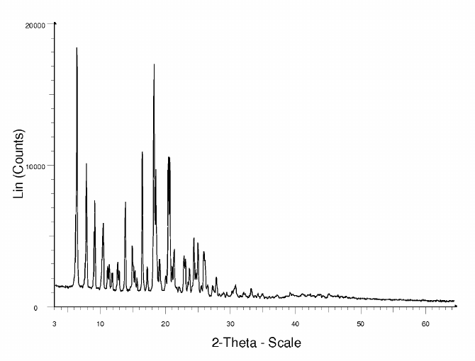
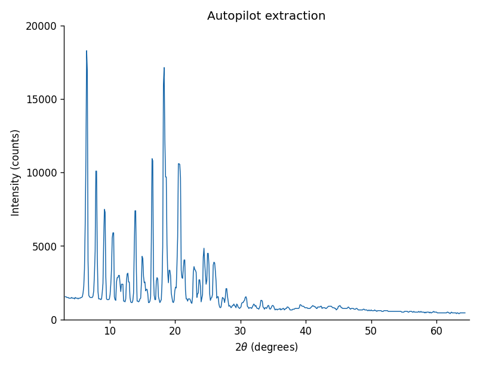
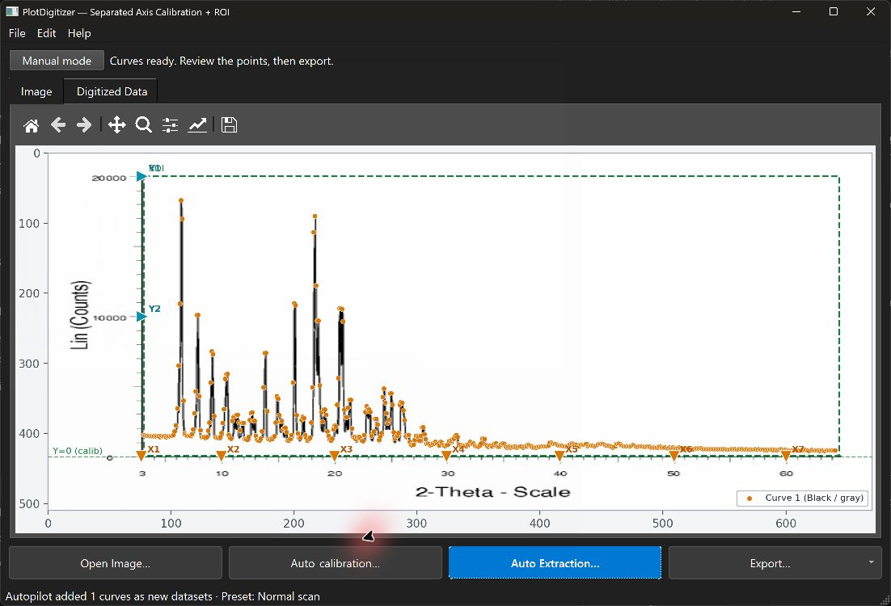
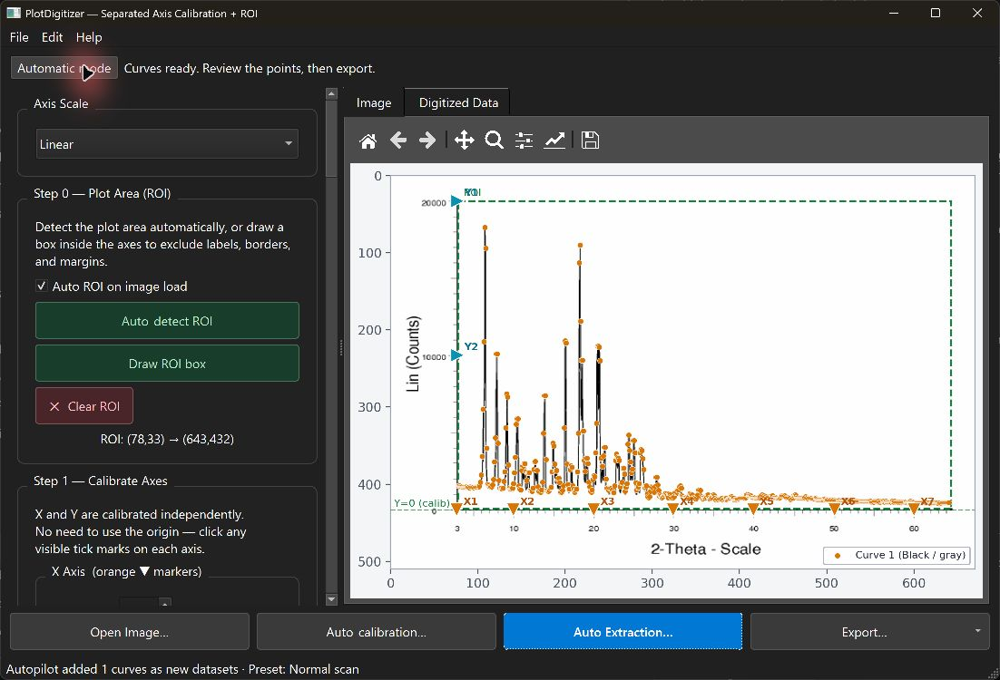

# PlotDigitizer

**Offline plot digitizer for PXRD, Raman and infrared spectroscopy.**

[](https://github.com/unwatcher/Plot_Digitizer/actions/workflows/tests.yml)
[](LICENSE)

Recover curves from scientific plot images and export **CSV, JSON or
HighScore-compatible XRDML**. Review automatic axis calibration and curve
extraction in the desktop app, or connect the same engine to scripts through
the **local REST API**. No account, cloud upload or API key is needed.

**[Download Windows preview](https://github.com/unwatcher/Plot_Digitizer/releases/download/v0.3.0-preview.1/PlotDigitizer-0.3.0-preview.1-ready-win64.zip)**
· [Download options](#windows-downloads)
· [Run from source](#run-from-source)
· [API guide](docs/API.md)
· [Contribute](CONTRIBUTING.md)

**Open Image → Auto-calibration → Auto Extraction → Review and Export**

| Original PXRD patent plot | Extracted numerical curve |
| --- | --- |
|  |  |

This example retains **563 observed points** with reviewed printed-axis
calibration and no smoothing or filling of missing columns.
[Download the CSV](examples/pxrd-extracted.csv), inspect the
[calibration/settings record](examples/pxrd-extraction.json), or try the
[four bundled examples](#four-patent-examples). It illustrates one extraction;
it is not an independent accuracy benchmark.

## Why use PlotDigitizer?

Autopilot detects the plot region, proposes axis calibration and extraction
settings, and previews curve candidates for review before export.

- **Extraction for spectra:** grid handling, stacked traces and downward IR dips,
  with linear, logarithmic and decreasing axes.
- **Review built into the workflow:** visible ROI/tick markers, curve overlays,
  overlap diagnostics and manual recovery in a resizable sidebar.
- **Scientific software handoff:** PXRD XRDML export plus CSV/JSON; source pixels
  and calibrated values remain distinct in API responses.
- **Local operation:** no account, cloud upload, API key or model download. The
  Windows ZIP includes Python and dependencies; OCR uses installed local support.

## Four actions from figure to data

| Action | What Autopilot does | What you review |
| --- | --- | --- |
| **Open Image** | Detects the plot region and displays the source figure. | Check the green ROI; adjust it if needed. |
| **Auto-calibration** | Reads numeric labels locally, matches visible ticks and proposes an axis model. | Check/edit tick positions and values, then apply calibration. |
| **Auto Extraction** | Separates colored/neutral traces, tries contrast/grid handling, and chooses upward-peak or downward-dip sampling. | Select curves and inspect the overlay/overlap regions. |
| **Export** | Writes CSV, JSON or PXRD XRDML. | Choose the format for your analysis workflow. |

The four actions stay at the bottom. The **Manual mode** toggle at the top left
opens a resizable controls sidebar on the left, with the image/data preview on
the right. The same button becomes **Automatic mode** and restores the full-width
preview. Switching modes preserves the image, calibration, datasets, selected
dataset and preview tab. The image and point table have separate tabs.

| [Automatic mode](docs/images/automatic-mode.png) | [Manual mode](docs/images/manual-mode.png) |
| --- | --- |
|  |  |

Click either screenshot to view it at full size. These source-build screenshots
show the mode toggle added after the v0.3.0-preview.1 ZIPs.
[Workflow steps and exported CSV](docs/workflow-demo.md).

Autopilot uses multiple threshold trials and trace continuity, with presets for
normal plots, grids, stacked curves and IR transmittance. It retains observed
samples, without smoothing or filling missing columns. Same-color crossings and
faint or touching strokes can need correction; coverage/separation labels are
review diagnostics, not calibrated confidence probabilities.

## Windows downloads

Choose the **v0.3 preview** for the desktop and local API described in this
README. The previous desktop release is also available:

| Release | Downloads | Includes |
| --- | --- | --- |
| **Current preview: v0.3.0-preview.1** | [Ready-to-run ZIP](https://github.com/unwatcher/Plot_Digitizer/releases/download/v0.3.0-preview.1/PlotDigitizer-0.3.0-preview.1-ready-win64.zip) · [Offline-wheel ZIP](https://github.com/unwatcher/Plot_Digitizer/releases/download/v0.3.0-preview.1/PlotDigitizer-0.3.0-preview.1-offline-wheels-win64.zip) · [Release notes and checksums](https://github.com/unwatcher/Plot_Digitizer/releases/tag/v0.3.0-preview.1) | Desktop Autopilot and bundled local API; a prerelease. |
| **Previous desktop: v0.2.0-preview.2** | [Release page and ZIPs](https://github.com/unwatcher/Plot_Digitizer/releases/tag/v0.2.0-preview.2) | Earlier desktop package, without the bundled local API. |

GitHub's **Latest** release currently points to v0.2. Use the explicit v0.3
links above for the new API workflow. Windows ZIPs are about **330–340 MB**
because they include Python and dependencies.

Both v0.3 ZIPs include portable Python 3.14.10 x64:

- **Ready-to-run:** extract the full folder and double-click `launch_plot_digitizer.bat`.
- **Offline wheels:** extract the full folder, run `install_dependencies.bat`, then launch.
  The installer verifies all 16 local wheels and uses no pip or network access.

No separate Python installation or administrator access is needed. Both packages
include the source, four screened patent examples, dependency license files and
SHA-256 metadata. Windows OCR still uses the language support installed in Windows.

## Run from source

PlotDigitizer supports Windows and Linux with 64-bit CPython 3.14. Clone the
repository (or extract its source ZIP), then create a virtual environment.

```text
git clone https://github.com/unwatcher/Plot_Digitizer.git
cd Plot_Digitizer
python -m venv .venv
```

Activate the environment (`.venv\Scripts\activate` on Windows or
`source .venv/bin/activate` on Linux), then run the following commands.

```text
python -m pip install -r requirements.txt
python plot_digitizer_auto.py
```

The existing `plot_digitizer_auto.py` entry point is preserved. Source is
organized in `plot_digitizer/`; no CrystalTrace installation or catalog is
required. Windows uses its installed OCR language support. If that engine
fails, an installed Tesseract on PATH is used. macOS and Linux need Tesseract for automatic axis suggestions. See the
[local OCR setup guide](docs/OCR.md). Manual calibration works without OCR.

## Handling difficult figures manually

| Situation | Manual recovery |
| --- | --- |
| Incorrect ROI or labels included | Draw a tight ROI around one plot panel and repeat extraction. |
| Faint trace, dense grid or wrong peak direction | Adjust the threshold, grid strength and topmost/bottommost selection. Normal, Grid, Waterfall and IR presets are available. |
| Same-color curves cross or merge | Inspect orange regions; isolate one curve with a Y-band/ROI where possible, use manual tracing through ambiguous portions, and reject incorrect points. Curve identities at crossings can remain unresolved. |
| OCR misses or misreads labels | Edit tick/value rows, click the correct ticks, or calibrate both axes manually. |
| IR/Raman axis changes scale along the plot | Use one consistent scale interval at a time. Calibrate and export each interval separately before changing calibration, then combine the reviewed segments externally. |

Use **Reject Points in Box** to remove incorrect points from the active dataset;
Ctrl+Z restores the last rejection. Linear, logarithmic and decreasing axes are
supported. A single global fit cannot represent a broken or piecewise axis.
Calibration is shared across datasets in the current window. Stacked-curve
offsets are retained as displayed and should be interpreted explicitly.

## Four patent examples

The before/after PXRD example at the top uses the Normal preset and threshold
160. Recreate its preview, CSV and settings record with
`python scripts/render_example.py` after installing `requirements.txt`.

Only four U.S. utility-patent plot crops are bundled, from two patent families:

| File in `examples/patent_plots/` | Source | Purpose |
| --- | --- | --- |
| `us8198452b2-fig1.png` | US8198452B2, Fig. 1 | Single PXRD trace |
| `us8198452b2-fig4.png` | US8198452B2, Fig. 4 | Faint Raman trace |
| `us8198452b2-fig7.png` | US8198452B2, Fig. 7 | Downward IR absorption dips; inspect axis spacing |
| `us6583283b1-fig8.png` | US6583283B1, Fig. 8 | Three stacked Raman curves and review diagnostics |

The [example provenance and reuse note](examples/README.md) records the selection
basis. The manifest includes source PDF URLs/hashes, page/crop/rotation details,
notice checks and sparse visual landmarks. No WIPO/Australian figures or supplied
clipboard scans are included. The software's BSD license is separate from the
figure reuse basis.

These are inspected examples and regression checks, not an independent accuracy
study. The earlier larger development corpus is not distributed here, and its
aggregate figures should not be read as performance claims for this example set.
Full curve identity and numeric calibration accuracy need independent validation.

## Connect your workflow with the local API

Double-click `launch_api.bat` in a **v0.3 preview** Windows release folder.
From source, install
`requirements-core.txt` and start the service without opening the desktop app:

~~~text
python -m plot_digitizer.api
~~~

In a second terminal, submit an image:

~~~text
python scripts/api_example.py examples/patent_plots/us8198452b2-fig1.png --output output/curves.json
~~~

The socket at `http://127.0.0.1:8765` offers `/health`, `/openapi.json`,
`/v1/extract` and `/v1/calibration`. Request pixel candidates or OCR proposals,
then supply reviewed calibration for numeric JSON/CSV or a selected PXRD curve
as XRDML. It uses the same engine as the GUI, adds no framework dependencies,
and does not retain uploaded images.

See the [API guide](docs/API.md) for examples, browser integration, limits and
XRDML options. The [GitHub tool review](docs/plot-digitizer-comparison.md) explains
the workflow and format choices behind this project.

## Headless use and module boundaries

Install `requirements-core.txt` for extraction and calibration inference without
Qt or Matplotlib:

```python
import cv2
from plot_digitizer import extract_plot_curves

bgr = cv2.imread("plot.png")
if bgr is None:
    raise ValueError("Could not read plot.png")
result = extract_plot_curves(cv2.cvtColor(bgr, cv2.COLOR_BGR2RGB))
# Review result["roi"], candidates, overlap_regions and threshold_trials.
```

Candidate coordinates are source-image pixels. Applying reviewed axis
calibration is a separate step. Inputs are preserved. Cancellation callbacks,
bounded image working resolution and local-OCR timeouts are supported.

| Module | Responsibility |
| --- | --- |
| `digitizer_core.py` | ROI, presets, curve extraction and separation diagnostics |
| `axis_ocr.py` | Local OCR adapters, word boxes and subprocess lifecycle |
| `axis_calibration.py` | Numeric parsing, observed-tick matching and fit validation |
| `gui.py` | Qt workers, review/correction and optional host integration |
| `exports.py` | Headless XRDML writer shared by GUI and API |
| `api.py` | Local HTTP socket, request validation and workflow responses |

CSV/JSON preserve floating-point coordinates, including small log-axis values.
SPA export is not implemented in the current version.
XRDML exports integer PXRD counts and is intended for diffraction software.
Current exports do not bundle the complete source image/calibration/settings
audit record; retain that context when building scientific datasets.

## Verification and reproduction

```text
python -m unittest discover -s tests -p "test_*.py" -v
python scripts/benchmark_plot_digitizer.py
python scripts/benchmark_plot_digitizer.py --calibration
```

Set `QT_QPA_PLATFORM=offscreen` for headless desktop tests. The optional
`--calibration` benchmark exercises the installed local OCR engine; unit tests
mock recognizers for repeatable failure and cancellation checks. HTML overlays
and JSON results are written under `output/patent_digitizer_benchmark/current`.
The benchmark checks image duplicates and family overlap, and receives no
annotations inside the extractor. Sparse landmarks measure supported pixels,
not complete curve accuracy or calibrated scientific values.

To recreate the four input crops from their original PDFs, install Pillow and
Poppler, then run `python scripts/fetch_patent_plot_corpus.py`. Supply
`--pdftoppm /path/to/pdftoppm` if necessary. Tests use bundled PNGs without
downloading documents. CI checks the two-dependency headless core on Ubuntu
and the desktop on Windows and Ubuntu. Verify native OCR on the target platform.

## Building Windows packages

On Windows, use native CPython 3.14 to download the pinned wheels and build both
portable package variants:

```text
python -m pip download --only-binary=:all: --require-hashes -r release/windows/requirements-offline.txt --dest .cache/wheelhouse
python scripts/build_windows_release.py --wheelhouse .cache/wheelhouse --source-revision YOUR_COMMIT_SHA
```

The builder downloads portable Python only from the pinned official URL and
verifies the checksum published by Python.org. It tests the actual extracted
ZIP contents before writing `SHA256SUMS.txt` and `release-manifest.json` under
`dist/`. Python/dependency licenses are retained inside each package. Release
uploads use GitHub Actions; existing tags or assets that belong to another
revision are never overwritten.

## Help and contributions

[Report a bug or request a feature](https://github.com/unwatcher/Plot_Digitizer/issues/new/choose).
Include your release tag or source commit, operating system and steps to
reproduce the problem. A bundled example or a small shareable image helps
diagnose extraction issues.

Documentation corrections, reproducible bug reports, scientific workflow
examples and focused code changes are welcome. See
[CONTRIBUTING.md](CONTRIBUTING.md) for setup, checks and example provenance.

## Cite PlotDigitizer

If you use PlotDigitizer in research, use the metadata in
[CITATION.cff](CITATION.cff) or GitHub's **Cite this repository** menu. Record the
release tag or commit you used alongside your reviewed calibration and
extraction settings. Cite source figures separately where applicable.

## License

The existing [BSD 3-Clause license](LICENSE), copyright 2026 unwatcher, is retained.
See [third-party notices](THIRD_PARTY_NOTICES.md) and the separate
[patent figure reuse note](examples/README.md).
