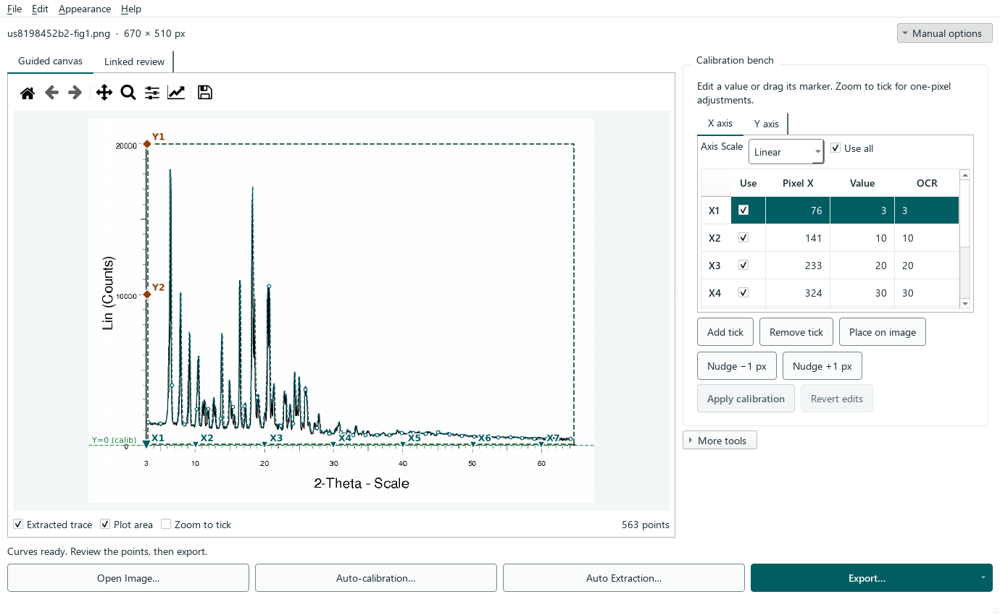
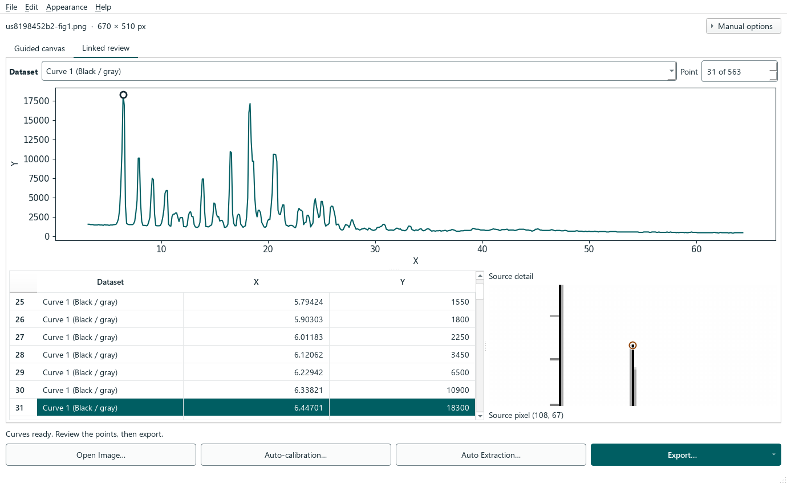

# Image-to-export walkthrough

These screenshots show one Windows desktop session extracting and reviewing
the bundled PXRD example. The [session metadata](../examples/workflow-demo.json)
records the source revision and the calibration, extraction and capture details.
Follow [Run from source](../README.md#run-from-source) to try this workspace.
The published v0.3.0-preview.1 Windows ZIPs contain the earlier layout.

## Guided canvas and calibration bench

## Linked review

## Try the workflow

1. Open `examples/patent_plots/us8198452b2-fig1.png`. Check the detected green
   plot-area boundary.
2. Choose **Auto-calibration**. Review each accepted label and its tick marker
   on both axes, then choose **Apply reviewed calibration**. This example
   accepts seven X ticks and two Y ticks, with linear scales. OCR proposals can
   differ by installed engine and language support.
3. Choose **Auto Extraction**. Inspect the highlighted candidate, then choose
   **Add selected curve**. Here Autopilot selects Normal scan and threshold 160.
4. In **Guided canvas**, check the trace overlay. Open **Manual options** to
   inspect the calibration bench. You can edit a tick value, drag its marker or
   nudge it by one pixel. Choose **Apply calibration** to update the extracted
   coordinates after editing.
5. In **Linked review**, click a curve point or table row. The selected sample
   appears in the trace, table and magnified source-image detail.
6. Choose **Export → Export CSV** and save the result. The app confirms that
   563 points were written.

## Actual output and provenance

The [recorded session's CSV](../examples/workflow-demo.csv) contains the actual
`dataset,x,y` output from the desktop exporter. X is 2Theta in degrees and Y
is intensity in counts for this PXRD example. Full floating-point values are
preserved. The desktop data table rounds values for display.

The [example metadata](../examples/workflow-demo.json) records the source
commit, input/output hashes, reviewed calibration points, extraction settings
and screenshot dimensions and hashes. This session uses a seven-tick X fit. The
separate [static PXRD reference](../examples/pxrd-extraction.json) uses a two-tick
X fit, so their exported coordinates differ slightly.

The source figure is US8198452B2, Fig. 1. See the
[example provenance and reuse note](../examples/README.md). The demonstration
is one reviewed example, not an independent accuracy or speed benchmark.

## Updating the screenshots

The images are Qt window captures from the same session as the CSV export.
To update them, run the workflow above on the intended source revision and
capture the calibration bench and linked review. Check the exported CSV, keep
local paths out of the captures, and update the screenshots, CSV and metadata
together.
